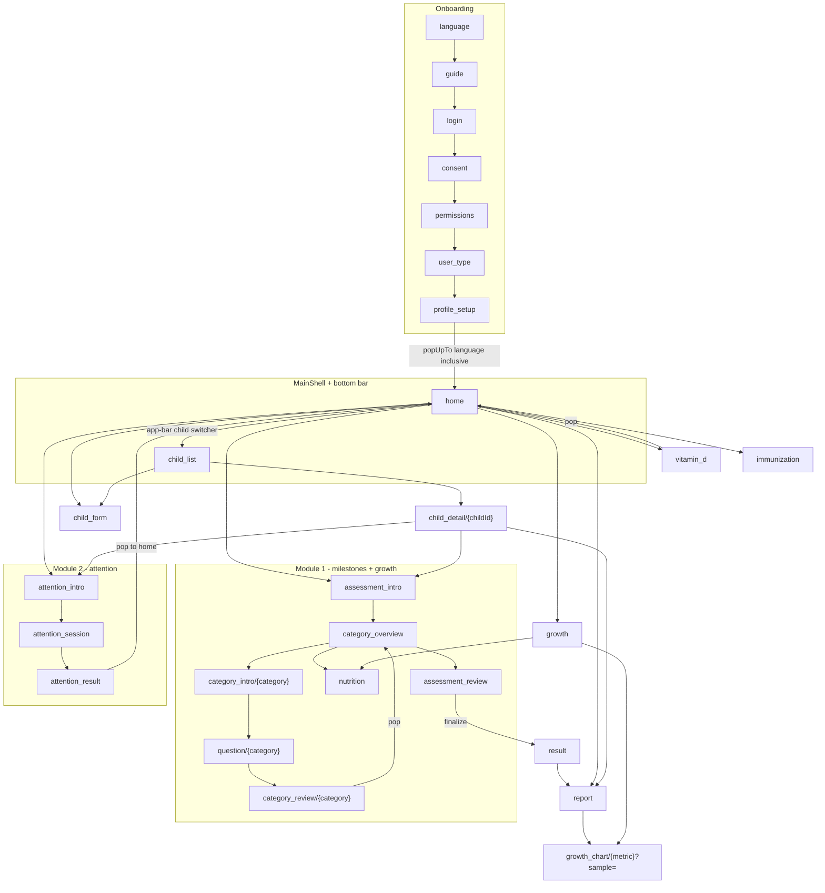
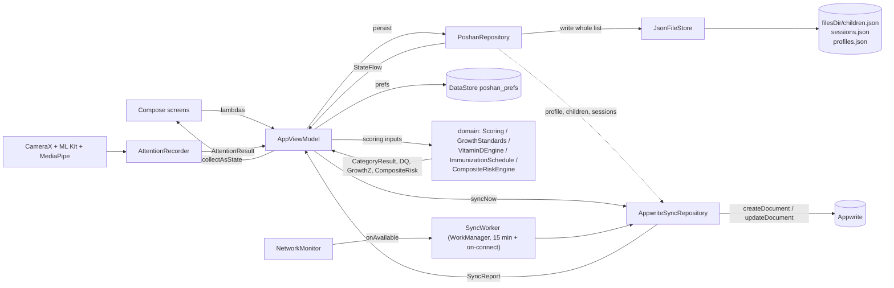

# 01 — Architecture

Poshan is a single-module Android app (`:app`) written in Kotlin with Jetpack Compose and
Material 3 Expressive. It screens children aged 0–60 months for developmental delay,
undernutrition, attention/social-orienting risk, vitamin D deficiency risk and overdue
immunisations. It is **offline-first**: every screen works with no network, all state is
written to the device filesystem synchronously, and Appwrite sync is an opportunistic
background push.

* Gradle module: `android/app` (`settings.gradle.kts` includes only `:app`)
* `namespace` / `applicationId`: `com.teamposhan.biomed`
* Source root: `android/app/src/main/java/com/teamposhan/biomed/`
* No test source sets exist. `testInstrumentationRunner` is declared in
  `android/app/build.gradle.kts` but there is no `src/test` or `src/androidTest` directory.

---

## 1. Package layout

```
com.teamposhan.biomed
├── MainActivity.kt          AppCompatActivity, edge-to-edge, hosts PoshanApp()
├── PoshanApplication.kt     builds PoshanContainer, inits Appwrite, restores locale, starts sync
├── data/
│   ├── local/               PoshanContainer, JsonFileStore, PrefsStore
│   ├── model/               Models.kt — every persisted entity
│   ├── remote/              AppwriteService, AuthRepository, AppwriteSyncRepository
│   ├── repo/                PoshanRepository — the single in-memory + on-disk store
│   └── sync/                NetworkMonitor, SyncWorker (WorkManager)
├── domain/                  pure Kotlin, no Android/Compose imports except LocationHelper
│   ├── age/                 AgeCalculator (chronological + corrected age)
│   ├── attention/           AttentionProtocol, AttentionRecorder, GazeTracker, FaceGazeAnalyzer
│   ├── growth/              WhoLms, GrowthStandards, GrowthInterpretation, SampleGrowthData
│   ├── immunization/        ImmunizationSchedule (NIS + IAP doses)
│   ├── location/            LocationHelper (platform LocationManager + Geocoder)
│   ├── milestones/          AgeBand, MilestoneQuestion, RedFlag, MilestoneBank
│   ├── risk/                VitaminDEngine, CompositeRiskEngine
│   ├── schedule/            AssessmentSchedule (per-age-band visit timeline)
│   └── scoring/             Scoring (category status, red flags, DQ)
├── locale/                  AppLocale — per-app language via AppCompatDelegate
└── ui/
    ├── AppViewModel.kt      the single ViewModel for the whole app
    ├── PoshanApp.kt         the NavHost + MainShell
    ├── components/          Components.kt — the shared design-system widgets
    ├── haptics/             AppHaptics + rememberAppHaptics()
    ├── navigation/          Routes.kt — route constants and builders
    ├── screens/             one file per screen cluster
    └── theme/               Color.kt, Type.kt, Theme.kt (MaterialExpressiveTheme)
```

### Why the split is drawn this way

| Layer | Rule it follows | Consequence |
|---|---|---|
| `domain/` | Pure functions and `object` singletons. Inputs are model data classes, outputs are model data classes. No coroutines, no Android framework (the exception is `domain/location/LocationHelper.kt`, which needs `Context`, and `domain/attention/*` which touch CameraX/ML Kit). | Scoring is deterministic and trivially unit-testable — although no tests exist yet. |
| `data/` | Owns persistence and the network. `PoshanRepository` is the only writer of local JSON; `AppwriteSyncRepository` is the only writer of remote documents. | The UI never touches a file or a socket. |
| `ui/` | Compose only. Screens are stateless functions taking data + lambdas; all state lives in `AppViewModel`. | Screens can be previewed; navigation logic is centralised in `PoshanApp.kt`. |
| `locale/` | A one-object wrapper over `AppCompatDelegate.setApplicationLocales`. | Language changes recreate the activity; no manual `Configuration` juggling. |

There is **no DI framework**. `PoshanContainer` is a hand-rolled container (16 lines,
`data/local/PoshanContainer.kt`) created once in `PoshanApplication.onCreate()` and passed
down through `MainActivity` → `PoshanApp(container)` → `AppViewModelFactory`.

---

## 2. State model

### 2.1 The container

`data/local/PoshanContainer.kt` exposes four singletons for the process:

| Field | Type | Role |
|---|---|---|
| `prefs` | `PrefsStore` | DataStore-Preferences: language, consent, onboarded, role, active child id |
| `repository` | `PoshanRepository` | children / sessions / profile, backed by JSON files |
| `auth` | `AuthRepository` | Appwrite account facade + offline guest profile |
| `sync` | `AppwriteSyncRepository` | pushes profile/children/sessions to Appwrite |

### 2.2 `JsonFileStore`

`data/local/JsonFileStore.kt` is a 39-line generic store:

* File location: `File(context.filesDir, fileName)` — on device
  `/data/data/com.teamposhan.biomed/files/<name>.json`.
* `Json { ignoreUnknownKeys = true; encodeDefaults = true; prettyPrint = false }`.
  `ignoreUnknownKeys` + defaulted constructor params is the entire schema-evolution
  strategy (see §4).
* `read()` returns `fallback()` on a missing file **or any decode failure** — a corrupt
  file silently becomes an empty list; there is no error surfaced and no backup taken.
* `write()` is "atomic-ish": write `<name>.json.tmp`, delete the target, `renameTo`. Both
  methods are `@Synchronized` on the store instance.
* Writes happen on the calling thread. `PoshanRepository` is called directly from
  `AppViewModel` on the main thread, so every answer tap performs a small main-thread file
  write. Files are small (one child's session JSON), but this is a real main-thread I/O
  path.

Three files are used:

| File in `filesDir` | Serializer | Written by |
|---|---|---|
| `children.json` | `ListSerializer(ChildProfile.serializer())` | `addChild` / `updateChild` / `removeChild` |
| `sessions.json` | `ListSerializer(AssessmentSession.serializer())` | `newSession` / `upsertSession` / `deleteSession` |
| `profiles.json` | `ListSerializer(UserProfile.serializer())` | `setProfile` / `clearProfile` (always a 0- or 1-element list) |

`android:allowBackup="true"` with `@xml/backup_rules` / `@xml/data_extraction_rules` is set
in the manifest, so these files participate in Android auto-backup with whatever those
rule files declare.

### 2.3 `PrefsStore`

`data/local/PrefsStore.kt` wraps a Preferences DataStore named `poshan_prefs`.

| Key | Type | Default | Meaning |
|---|---|---|---|
| `language` | String | `"en"` | last chosen language tag |
| `consented` | Boolean | `false` | consent screen accepted |
| `onboarded` | Boolean | `false` | onboarding finished |
| `role` | String | `""` | `UserRole.name` |
| `active_child_id` | String | `""` | the child the Home screen is showing |

### 2.4 `PoshanRepository`

`data/repo/PoshanRepository.kt` holds three `MutableStateFlow`s seeded from the JSON stores
at construction, and re-writes the whole list to disk on every mutation. Exposed as
`children`, `sessions`, `profile` (`StateFlow`s).

### 2.5 `AppViewModel`

`ui/AppViewModel.kt` is the only ViewModel. It is created in `PoshanApp` via
`viewModel(factory = AppViewModelFactory(container))`, so its lifetime is the activity.

| StateFlow | Type | Source |
|---|---|---|
| `children` | `List<ChildProfile>` | delegated straight to `repo.children` |
| `sessions` | `List<AssessmentSession>` | delegated to `repo.sessions` |
| `profile` | `UserProfile?` | delegated to `repo.profile` |
| `session` | `AssessmentSession?` | the **in-progress** session; VM-owned, not persisted as "current" |
| `activeChild` | `ChildProfile?` | VM-owned; hydrated from `prefs.activeChildId`, auto-selected when exactly one child exists |
| `role` | `UserRole` | collected from `prefs.role`, default `PARENT` |
| `language` | `String` | read once from `prefs.currentLanguage()` |
| `onboarded` | `Boolean?` | **nullable on purpose** — `null` means "not yet read", used to gate the start destination |
| `syncing` | `Boolean` | true while `syncNow()` is in flight |
| `syncState` | `AppwriteSyncRepository.SyncReport?` | last sync outcome/message |
| `lastGaze` | `AttentionMetrics?` | raw metrics from the last attention run, for the result screen only (never persisted) |

Key behaviours:

* **Session creation** — `startSession(child)` returns the existing draft if one is already
  in `_session` for the same child; otherwise `repo.newSession(childId)` mints a
  `UUID.randomUUID()` id, writes it to disk immediately, then `copy()`s in
  `ageMonthsAtAssessment` (= assessment age, i.e. corrected if premature),
  `correctedAgeMonths` and `assessorRole`, and upserts again.
* **Persistence** — every mutator (`answer`, `saveGrowth`, `saveNutrition`,
  `saveAttention`, `saveVitaminD`, `toggleVaccine`) funnels through `private fun persist()`
  which does `repo.upsertSession(session)` (disk write) then `_session.value = session`.
  There is no "save" button anywhere in the assessment flow; an interrupted screening is
  always resumable from disk.
* **Completion** — `finalize()` runs `Scoring.evaluate(...)`,
  `ImmunizationSchedule.overdueFraction(...)` and `CompositeRiskEngine.compute(...)`, then
  writes a copy with `completedAt`, `categoryResults`, `dq`, `composite` and
  `status = COMPLETED`. `submitCurrent()` is an alias for `finalize()`.
* **Resume** — `resumeLatestDraft(child)` exists on the ViewModel but **is not called from
  `PoshanApp.kt`** (see Known gaps).
* `SessionStatus.SYNCED` exists in the model but is never assigned anywhere; sync does not
  write back a status.

---

## 3. Navigation

Routes are string constants in `ui/navigation/Routes.kt`; the `NavHost` is built inline in
`ui/PoshanApp.kt`. Start destination is `HOME` when `onboarded == true`, else `LANGUAGE`;
while `onboarded` is still `null` a full-screen `PoshanLoader()` is shown and the NavHost is
not composed at all.

Transitions are global on the NavHost: slide-in + fade enter, fade exit, fade pop-enter,
slide-out + fade pop-exit (`tween` 140–260 ms).

### 3.1 Route table

| Route constant | Route string | Args | Screen composable | Reached from |
|---|---|---|---|---|
| `LANGUAGE` | `language` | — | `LanguageScreen` | start destination when not onboarded |
| `GUIDE` | `guide` | — | `GuideScreen` | language picked |
| `LOGIN` | `login` | — | `LoginScreen` | guide continue |
| `CONSENT` | `consent` | — | `ConsentScreen` | `onPhoneLogin` **or** `onGuest` (both go here) |
| `PERMISSIONS` | `permissions` | — | `PermissionsScreen` | consent accepted |
| `USER_TYPE` | `user_type` | — | `UserTypeScreen` | permissions primer done |
| `PROFILE_SETUP` | `profile_setup` | — | `ProfileSetupScreen` | role picked; on submit `completeOnboarding` then `navigate(HOME) { popUpTo(LANGUAGE) { inclusive = true } }` |
| `HOME` | `home` | — | `HomeScreen` inside `MainShell` | start destination when onboarded; bottom bar |
| `CHILD_LIST` | `child_list` | — | `ChildListScreen` inside `MainShell` (title "Children") | app-bar child-switcher action on Home; `onOpenChild` |
| `CHILD_FORM` | `child_form` | — | `ChildFormScreen` in `PoshanScaffold` | "Add child"; also the fallback when an action needs a child and `activeChild == null` |
| `CHILD_DETAIL` | `child_detail/{childId}` | `childId: String` | `ChildDetailScreen` | tapping a child in `ChildListScreen` (also sets active child) |
| `ASSESSMENT_INTRO` | `assessment_intro` | — | `AssessmentIntroScreen` | Home "start assessment" (after `startSession`), child detail |
| `CATEGORY_OVERVIEW` | `category_overview` | — | `CategoryOverviewScreen` | assessment intro start |
| `CATEGORY_INTRO` | `category_intro/{category}` | `category: String` (`AssessmentCategory.name`) | `CategoryIntroScreen` | category tile on the overview |
| `QUESTION` | `question/{category}` | `category: String` | `QuestionScreen` | category intro start; "edit" on category review |
| `CATEGORY_REVIEW` | `category_review/{category}` | `category: String` | `CategoryReviewScreen` | finishing a category's questions; continue does `popBackStack(CATEGORY_OVERVIEW, inclusive = false)` |
| `NUTRITION` | `nutrition` | — | `NutritionScreen` | overview "nutrition" tile; growth hub "record measurement" |
| `ASSESSMENT_REVIEW` | `assessment_review` | — | `AssessmentReviewScreen` | overview "review"; submit calls `finalize()` then `navigate(RESULT) { popUpTo(HOME) { inclusive = false } }` |
| `RESULT` | `result` | — | `ResultScreen` | assessment review submit |
| `ATTENTION_INTRO` | `attention_intro` | — | `AttentionIntroScreen` | Home attention tile; child detail |
| `ATTENTION_SESSION` | `attention_session` | — | `AttentionSessionScreen` (full screen, **no** `PoshanScaffold`) | attention intro start |
| `ATTENTION_RESULT` | `attention_result` | — | `AttentionResultScreen` | attention session complete (`saveAttention` + `recordGazeMetrics`) |
| `VITAMIN_D` | `vitamin_d` | — | `VitaminDScreen` | Home vitamin D tile (starts a session first if none); pops back on save |
| `IMMUNIZATION` | `immunization` | — | `ImmunizationScreen` | Home immunisation tile |
| `REPORT` | `report` | — | `ReportScreen` | bottom bar; Home; result screen; child detail |
| `GROWTH` | `growth` | — | `GrowthChartsHubScreen` | Home "growth charts" |
| `GROWTH_CHART` | `growth_chart/{metric}?sample={sample}` | `metric: String` (`GrowthStandards.Metric.name`), `sample: Bool` (default `false`) | `GrowthChartDetailScreen` (full screen) | `onOpenChart` from the report and the growth hub |

Route builders: `Routes.childDetail(id)`, `categoryIntro(name)`, `question(name)`,
`categoryReview(name)`, `growthChart(metric, sample)`.

Unknown/garbled category arguments fall back to `GROSS_MOTOR` via the private
`categoryOf()` helper; an unknown metric falls back to `WEIGHT_FOR_AGE` via
`runCatching { Metric.valueOf(..) }.getOrDefault(..)`.

### 3.2 `MainShell` and the bottom bar

`MainShell` (private in `PoshanApp.kt`) wraps a destination in `PoshanScaffold` plus
`PoshanBottomBar`. Only **two** destinations use it: `HOME` and `CHILD_LIST`.

The bottom bar has two items only:

| Item | Route | Icon |
|---|---|---|
| Home | `Routes.HOME` | `Icons.Filled.Home` |
| Report | `Routes.REPORT` | `Icons.Filled.BarChart` |

Switching child is **not** a tab — it is an app-bar action (`ChildSwitcherAction`, defined
in `ui/screens/HomeScreens.kt:779`) rendered in the Home destination's `actions` slot, which
navigates to `CHILD_LIST`. Because `CHILD_LIST` is not in `bottomItems`, `MainShell` keeps
Home visually selected while it is open. Bottom-bar navigation uses
`popUpTo(Routes.HOME) { inclusive = target == Routes.HOME }` + `launchSingleTop = true`.

Note that `Routes.REPORT` itself is **not** wrapped in `MainShell` — it renders in a plain
`PoshanScaffold`, so tapping "Report" in the bottom bar navigates to a screen that has no
bottom bar.

### 3.3 Navigation graph



---

## 4. Data model (`data/model/Models.kt`)

Every type in this file is `@Serializable` (kotlinx.serialization). Enums are serialised by
name.

### 4.1 Enums

| Enum | Values |
|---|---|
| `Sex` | `MALE`, `FEMALE`, `OTHER` |
| `UserRole` | `PARENT`, `ANGANWADI_WORKER`, `HEALTHCARE_FACILITY`, `ADMIN` |
| `AssessmentCategory` | `GROSS_MOTOR`, `FINE_MOTOR`, `COMMUNICATION`, `SOCIAL_EMOTIONAL`, `NUTRITION` |
| `ResponseType` | `YES_OBSERVED`, `NOT_YET`, `NOT_SURE`, `COULD_NOT_TRY` |
| `EvidenceSource` | `OBSERVATION`, `CAREGIVER_REPORT` |
| `DomainStatus` | `ON_TRACK`, `CONCERN`, `DELAYED`, `NOT_ASSESSED` |
| `RiskBand` | `ON_TRACK`, `MONITOR`, `REVIEW`, `PRIORITY` (ordinal order matters — compared with `>=` in `CompositeRiskEngine`) |
| `SessionStatus` | `DRAFT`, `COMPLETED`, `SYNCED` (`SYNCED` never assigned) |
| `AttentionTaskType` | `PREFERENTIAL_LOOKING`, `RESPONSE_TO_NAME`, `DISENGAGEMENT`, `GENERAL_MOVEMENT` |
| `MuacBand` | `NORMAL`, `MAM`, `SAM`, `NOT_APPLICABLE` |

### 4.2 Root entities

**`UserProfile`** — one per install (`profiles.json` holds a 0/1-element list).

| Field | Type | Default |
|---|---|---|
| `id` | String | required (guest ids are `"local-" + 8 uuid chars`) |
| `role` | `UserRole` | required |
| `displayName`, `phone`, `relationship`, `location` | String | `""` |
| `anganwadiName`, `anganwadiCode` | String | `""` (AWW role) |
| `facilityName`, `hfrId`, `employeeId` | String | `""` (facility role) |
| `isGuest` | Boolean | `true` |
| `createdAt` | Long | `System.currentTimeMillis()` |

**`ChildProfile`** — 1:N from the install, referenced by `AssessmentSession.childId`.

| Field | Type | Default |
|---|---|---|
| `id` | String | required (UUID from `vm.newChildId()`) |
| `name` | String | required |
| `dateOfBirthEpochDay` | Long | required (`LocalDate.toEpochDay()`) |
| `sex` | `Sex` | required |
| `bornPremature` | Boolean | `false` |
| `gestationalAgeWeeks` | `Int?` | `null` |
| `parentName`, `parentMobile`, `village` | String | `""` |
| `baselineWeightKg`, `baselineHeightCm`, `baselineMuacMm` | `Float?` | `null` — anthropometry captured at profile creation, used by `latestAnthropometry()` as a fallback |
| `createdByRole` | `UserRole` | `PARENT` |
| `createdAt` | Long | now |

**`AssessmentSession`** — the aggregate root of one screening.

| Field | Type | Default | Notes |
|---|---|---|---|
| `id` | String | required | UUID; also the Appwrite document id |
| `childId` | String | required | FK → `ChildProfile.id` |
| `startedAt` | Long | now | also used as `assessment_date` / `record_date` remotely |
| `completedAt` | `Long?` | `null` | set by `finalize()` |
| `ageMonthsAtAssessment` | Float | `0f` | **corrected** age if premature and < 24 mo, else chronological |
| `correctedAgeMonths` | `Float?` | `null` | |
| `answers` | `List<AssessmentAnswer>` | `[]` | |
| `growth` | `GrowthMeasurement?` | `null` | |
| `growthZ` | `GrowthZ?` | `null` | computed in `saveGrowth()` |
| `nutrition` | `NutritionData?` | `null` | |
| `attention` | `AttentionResult?` | `null` | |
| `vitaminD` | `VitaminDResult?` | `null` | |
| `givenVaccines` | `List<String>` | `[]` | `VaccineDose.id` values |
| `dq` | `DevelopmentalQuotient?` | `null` | set by `finalize()` |
| `categoryResults` | `List<CategoryResult>` | `[]` | set by `finalize()` |
| `composite` | `CompositeRisk?` | `null` | set by `finalize()` |
| `status` | `SessionStatus` | `DRAFT` | |
| `assessorRole` | `UserRole` | `PARENT` | |

Computed members: `answerFor(questionId)`, `answeredCount`.

### 4.3 Value objects

| Type | Fields | Notes |
|---|---|---|
| `AssessmentAnswer` | `questionId`, `category`, `response: ResponseType?`, `evidence = OBSERVATION`, `updatedAt` | `isConcern` = `NOT_YET`/`NOT_SURE`; `isUnresolved` = `null`/`COULD_NOT_TRY`. `evidence` is defaulted and, as far as the UI goes, never set to `CAREGIVER_REPORT`. |
| `GrowthMeasurement` | `dateMillis`, `weightKg?`, `heightCm?`, `muacMm?` | MUAC in **millimetres** |
| `GrowthZ` | `weightForAge?`, `heightForAge?`, `bmiForAge?`, `muacForAge?` | `worst` = min of the first three (deliberately excludes MUAC-for-age) |
| `GrowthFinding` | `label`, `detail`, `severity: DomainStatus` | produced by `GrowthInterpretation` |
| `NutritionData` | `feedingStatus`, `foodGroups`, `mealsPerDay?`, `supplements`, `feedingDifficulty`, `recentIllness`, `foodAccessConcern`, `dietaryDiversityScore` | |
| `AttentionResult` | `taskType`, `validFrameRatio`, `onScreenRatio`, `socialAttentionRatio`, `blinkRatePerMin`, `disengagementLatencyMs?`, `responseToNameRatio?`, `engagementIndex`, `band`, `inconclusive = true`, `durationMs` | `inconclusive` defaults to **true**, so an unvalidated run contributes nothing to composite risk |
| `VitaminDResult` | `score`, `band`, `factors` | |
| `CategoryResult` | `category`, `answered`, `total`, `concerns`, `status`, `redFlags`, `missedEarlier`, `earliestMissBand?` | |
| `DevelopmentalQuotient` | `developmentalAgeMonths`, `chronologicalAgeMonths`, `dq` | |
| `CompositeRisk` | `devScore`, `growthScore`, `attentionScore`, `vitaminDScore`, `immunizationScore`, `overall`, `band`, `reasons`, `referrals` | |

### 4.4 Relationships

```
UserProfile (0..1)
ChildProfile (0..n) ──1:n──▶ AssessmentSession
                                 ├── AssessmentAnswer (0..n)   → MilestoneQuestion.id
                                 ├── GrowthMeasurement (0..1) ─▶ GrowthZ (0..1)
                                 ├── NutritionData (0..1)
                                 ├── AttentionResult (0..1)
                                 ├── VitaminDResult (0..1)
                                 ├── givenVaccines: [VaccineDose.id]
                                 └── CategoryResult (0..4) + DevelopmentalQuotient + CompositeRisk
```

### 4.5 Schema evolution

There is no version field and no migration code. Evolution relies entirely on:

1. `Json { ignoreUnknownKeys = true }` in `JsonFileStore` and in `AppwriteSyncRepository` —
   a field removed from the model is dropped when reading an older file.
2. **Every new field must have a default.** Adding a non-defaulted required field to any
   entity will make `decodeFromString` throw, and `JsonFileStore.read()`'s
   `runCatching { }.getOrElse { fallback() }` will silently return an empty list — i.e.
   every child and every session on the device disappears from the UI with no error.
   This is the single most dangerous edit in the codebase.
3. `encodeDefaults = true`, so files are always written fully populated.

Remote schema evolution is separate and manual: `appwrite/schema.ps1` provisions
collections and attributes, and `AppwriteSyncRepository.describe()` tells the user to re-run
it when Appwrite returns `collection_not_found`, `user_unauthorized` or
`document_invalid_structure`.

---

## 5. Assessment lifecycle, end to end

1. **Child profile** — `ChildFormScreen` builds a `ChildProfile` (id from
   `vm.newChildId()`), `vm.addChild()` writes `children.json`, then `setActiveChild()`
   persists `active_child_id`. Baseline weight/height/MUAC may be captured here.
2. **Session start** — Home "start assessment" calls `vm.startSession(activeChild)`.
   `AgeCalculator.assessmentMonths()` resolves the age: corrected age when
   `bornPremature && gestationalAgeWeeks < 40 && chronological < 24 mo`, else chronological
   (`days / 30.4375`). The session is on disk before the first question is shown.
3. **Module 1 — milestone questions** — `CategoryOverviewScreen` lists the four
   developmental categories (`vm.scoredCategories()` recomputes live) plus a Nutrition tile.
   Per category, `vm.questionsFor(category)` calls
   `MilestoneBank.catchUpQuestions(age, category)`, which returns **every band up to and
   including the child's own band** — catch-up screening, so a child first seen at 11 months
   is still asked the 0–3 month items. `QuestionScreen` calls `vm.answer(...)` per response;
   each answer is a disk write. `CategoryReviewScreen` pops back to the overview.
4. **Growth / nutrition** — `NutritionScreen` returns `(NutritionData, GrowthMeasurement)`.
   `vm.saveNutrition()` then `vm.saveGrowth()`; the latter immediately computes
   `GrowthStandards.z(sex, ageMonths, weightKg, heightCm, muacMm)` from the WHO LMS tables in
   `domain/growth/WhoLms.kt` and stores `GrowthZ` on the session.
5. **Module 2 — attention** — reached independently from Home (it is *not* part of the
   module 1 review flow). `AttentionSessionScreen` runs the age-banded protocol from
   `domain/attention/AttentionProtocol.kt` (`MOVEMENT` < 5 mo, `INFANT` 5–24 mo,
   `PRESCHOOL` 24–60 mo) over CameraX + ML Kit face detection + MediaPipe tasks-vision;
   `AttentionRecorder` turns the gaze sample stream into metrics with per-trial validity
   gating. On completion `vm.saveAttention(result)` persists an `AttentionResult` and
   `vm.recordGazeMetrics()` keeps the raw metrics in memory for the result screen.
6. **Vitamin D** — `VitaminDScreen` collects a `VitaminDInput` questionnaire;
   `vm.saveVitaminD()` runs `VitaminDEngine.assess()` (weighted 0–12 point score →
   `ON_TRACK` < 2, `MONITOR` 2–3, `REVIEW` 4–7, `PRIORITY` ≥ 8) and persists the result.
   This is explicitly **not** a blood test.
7. **Immunisation** — `ImmunizationScreen` toggles `VaccineDose.id`s into
   `session.givenVaccines` against the NIS + IAP schedule in
   `domain/immunization/ImmunizationSchedule.kt` (overdue = `ageDays > dueAgeDays + 30`).
8. **Scoring** — `vm.finalize()`:
   * `Scoring.evaluate(assessedAge, chronologicalAge, answers)` →
     per-category `CategoryResult` (status from red flags → missed-earlier milestones →
     `currentConcerns >= max(2, ceil(0.5 × currentBandQuestions))` → ≥1 concern), triggered
     `RedFlag`s from the AIIMS chart, and a `DevelopmentalQuotient`
     (dev age accumulated band-by-band, `DQ = devAge / chronoAge × 100`; ≥85 on track,
     ≥70 concern, else delayed).
   * `ImmunizationSchedule.overdueFraction(ageDays, given)`.
   * `CompositeRiskEngine.compute(...)` — weighted 0.40 dev / 0.20 growth / 0.20 attention /
     0.10 vitamin D / 0.10 immunisation, plus hard band overrides (any red flag or ≥2
     delayed domains ⇒ `PRIORITY`), producing `reasons` and `referrals`. Attention only
     contributes when `!attention.inconclusive`.
   * Session is copied with `status = COMPLETED` and written to disk.
9. **Result** — `ResultScreen` renders the composite band, DQ, category statuses,
   attention, vitamin D and growth z-scores.
10. **Report** — `ReportScreen` renders the full record plus WHO growth charts
    (`growthHistoryFor()` at `ui/screens/ResultScreen.kt:608` builds the trajectory from all
    sessions for the child). Tapping a chart opens `GROWTH_CHART` full screen; the `sample`
    flag swaps in `SampleGrowthData`'s fabricated (never persisted) trajectory for
    demonstrating the chart bands.
11. **Sync** — see §6.3.

### Data flow



---

## 6. Cross-cutting concerns

### 6.1 Localisation

* `locale/AppLocale.kt` supports `en`, `hi`, `te` and applies the choice with
  `AppCompatDelegate.setApplicationLocales(...)`, which recreates running activities.
  `MainActivity` extends `AppCompatActivity` specifically so this works.
* Persistence: on Android 13+ the system stores the per-app language; on 12 and below the
  `androidx.appcompat.app.AppLocalesMetadataHolderService` with
  `autoStoreLocales = true` (declared in the manifest) does it. `PrefsStore.language` keeps
  a second copy, re-applied in `PoshanApplication.onCreate()` via a `runBlocking` read.
* `res/xml/locales_config.xml` lists `en`/`hi`/`te` so the choice appears in
  Settings → Apps → Poshan → Language.
* Resource counts: `values/strings.xml` 305 strings, `values-hi/strings.xml` 247,
  `values-te/strings.xml` 247 — **58 strings are untranslated** in both Hindi and Telugu.
* `stringResource` is used 217 times, but only in six files:
  `ui/components/Components.kt`, `ui/screens/AssessmentScreens.kt`,
  `ui/screens/AttentionScreen.kt`, `ui/screens/HomeScreens.kt`,
  `ui/screens/OnboardingScreens.kt`, `ui/screens/ResultScreen.kt`. Everything else —
  including every `PoshanScaffold(title = ...)` in `PoshanApp.kt` ("Screening",
  "Categories", "Review", "Nutrition & growth", "Child details", "Growth charts",
  "Attention & gaze", "Result", "Report", "Immunization", "Vitamin D risk"), the bottom-bar
  labels, and all of `domain/` (milestone question text, vaccine names, referral strings,
  growth findings) — is hardcoded English.

### 6.2 Theming, haptics, permissions

* **Theme** — `ui/theme/Theme.kt` uses `MaterialExpressiveTheme` (opt-in
  `ExperimentalMaterial3ExpressiveApi`) with `MotionScheme.expressive()`, custom
  `PoshanShapes` and `poshanTypography()`. Hand-authored light and dark `ColorScheme`s
  (`Color.kt`); **no dynamic colour**. Two extra palettes ride on CompositionLocals:
  `LocalRiskColors` (`RiskBand` → colour + soft container) and `LocalAccentColors`, read via
  the `riskColors` / `accentColors` composable accessors. Dark mode follows
  `isSystemInDarkTheme()` only — there is no in-app theme toggle.
* **Haptics** — `ui/haptics/AppHaptics.kt` exposes semantic calls `tick()`, `click()`,
  `confirm()`, `reject()`, `success()`. API 31+ uses `VibrationEffect.Composition`
  primitives for `success()` when `arePrimitivesSupported`; API 29+ uses
  `createPredefined`; below that a flat 30 ms vibrate. Obtain one with
  `rememberAppHaptics()`. Requires `VIBRATE`.
* **Permissions** — declared in `android/app/src/main/AndroidManifest.xml`: `INTERNET`,
  `ACCESS_NETWORK_STATE`, `VIBRATE`, `CAMERA`, `POST_NOTIFICATIONS`,
  `ACCESS_FINE_LOCATION`, `ACCESS_COARSE_LOCATION`, plus
  `<uses-feature android:name="android.hardware.camera.front" android:required="false" />`.
  `PermissionsScreen` is a primer shown during onboarding; runtime requests are made by the
  screens that need them (camera in `AttentionScreen`, location via
  `LocationHelper.hasPermission`).
* **Location** — `domain/location/LocationHelper.kt` deliberately avoids Play Services: it
  drives the platform `LocationManager` and actively requests a fix (last-known is only a
  fallback, because on a phone where nothing else has asked, last-known is null), then
  reverse-geocodes with the platform `Geocoder`, degrading to a coordinate string. An
  optional `setMapsApiKey(key)` switches to the network geocoder; **nothing in the app
  currently calls `setMapsApiKey`**, so that path is dead code today.

### 6.3 Background sync

* `PoshanApplication.onCreate()` calls `SyncWorker.schedule(context)` and starts a
  `NetworkMonitor`.
* `SyncWorker` (`data/sync/SyncWorker.kt`) is a `CoroutineWorker`:
  * periodic, unique name `poshan-periodic-sync`, 15 minutes, `ExistingPeriodicWorkPolicy.KEEP`,
    constraint `NetworkType.CONNECTED`, exponential backoff from 30 s;
  * one-shot, unique name `poshan-immediate-sync`, `ExistingWorkPolicy.REPLACE`, backoff
    from 15 s — enqueued by `NetworkMonitor.onAvailable` and on start when already online;
  * `MAX_ATTEMPTS = 5`; a non-retryable `SyncReport` (schema/permission failure) returns
    `Result.failure()` immediately rather than burning battery.
* `AppwriteSyncRepository.syncAll(profile, children, sessions)` uploads **everything, every
  time** — there is no dirty tracking or cursor. Each document is attempted independently.
  Writes are create-then-update-on-409 upserts, so they are idempotent.
* Permissions per document are `read/update/delete(Role.user(ownerId))` only; admin-wide
  read is granted at collection level by `appwrite/schema.ps1`, because a client SDK may
  only grant roles the session actually holds (granting `label:admin` from the device
  returns 401 `user_unauthorized`).
* Collections: `profiles`, `children`, `assessments`, `growth_records`,
  `attention_records`, `vitamin_d_records`. One session can yield up to four documents;
  sub-document ids are `subDocumentId(sessionId, suffix)` — the 36-char Appwrite id limit
  means the UUID is truncated and `_attn` / `_vitd` / `_growth` appended.
* Complex session fields are stored as JSON strings (`answers_json`, `growth_json`,
  `nutrition_json`, `attention_json`, `vitamin_d_json`, `given_vaccines_json`,
  `category_results_json`, `composite_json`).
* Sign-in is an anonymous Appwrite session (`AuthRepository.ensureRemoteSession`), with a
  specific workaround for the `user_session_already_exists` case.
* Everything is gated on `AppwriteService.isConfigured` = `BuildConfig.APPWRITE_ENABLED &&
  APPWRITE_PROJECT_ID.isNotBlank()`. With it off the app is 100% local.

---

## 7. Known gaps and caveats

Things that will otherwise cost a new developer an afternoon.

1. **No Gradle wrapper.** `android/gradlew` / `gradlew.bat` and
   `gradle/wrapper/gradle-wrapper.properties` do not exist; only
   `android/gradle/libs.versions.toml` is there. See `docs/09-build-and-release.md` for the
   command that works.
2. **No tests at all.** No `src/test`, no `src/androidTest`, no test dependencies in
   `build.gradle.kts` — despite `testInstrumentationRunner` being configured. The domain
   layer (scoring, WHO LMS, immunisation, risk engines) is pure and would be cheap to cover.
3. **Adding a non-defaulted field to any model silently wipes local data** — see §4.5.
   `JsonFileStore.read()` swallows every decode exception and returns the empty fallback.
   There is no corrupted-file backup and no logging.
4. **Main-thread disk writes.** `AppViewModel.persist()` → `repo.upsertSession()` →
   `JsonFileStore.write()` runs synchronously on the caller's thread, which is the Compose
   main thread for every answer tap, vaccine toggle and measurement save. It also rewrites
   the *entire* sessions list each time.
5. **`SessionStatus.SYNCED` is dead.** Nothing ever sets it; sync does not mark records.
   Combined with #6 this means the app re-uploads the entire local database on every sync
   cycle (every 15 minutes while online).
6. **Sync has no dirty tracking.** `syncAll` pushes every profile, child and session on each
   run. Fine at hackathon data volumes; not fine for an Anganwadi worker with hundreds of
   children.
7. **`resumeLatestDraft()` is never called.** `AppViewModel` implements draft resume, but no
   navigation path invokes it. After a process death the `_session` StateFlow is null, so
   Home's "start assessment" creates a *second* draft session for the same child rather than
   resuming the one on disk. Drafts accumulate.
8. **Dead branch in `startSession()`**:
   ```kotlin
   if (corrected != null && corrected != chrono) {
       // keep chrono via ageMonthsAtAssessment already corrected; store chrono in dq later
   }
   ```
   An empty `if` with a comment. Harmless but misleading.
9. **`finalize()` returns a fabricated empty session** (`AssessmentSession(id = "empty",
   childId = "")`) when `_session` is null instead of a nullable/`Result`. That sentinel is
   not persisted, but callers cannot distinguish it from a real result.
10. **`Routes.REPORT` is a bottom-bar tab but is not wrapped in `MainShell`**, so selecting
    it removes the bottom bar. There is no way back to Report from the bar once you leave.
11. **Login is cosmetic.** In `PoshanApp.kt` both `onPhoneLogin` and `onGuest` navigate to
    `CONSENT` with no auth performed. `AuthRepository.requestPhoneToken` /
    `confirmPhoneToken` / `signInEmail` are implemented but unreferenced from the UI.
    Every user is effectively an anonymous Appwrite session.
12. **Partial localisation.** 58 English strings have no `hi`/`te` translation, and most
    user-visible text outside the six `stringResource`-using files is hardcoded English —
    including every screen title in `PoshanApp.kt` and all milestone question text in
    `domain/milestones/MilestoneData.kt`. A Hindi/Telugu user still sees English titles.
13. **UTF-8 BOM + mojibake in five source files.**
    `ui/PoshanApp.kt`, `ui/screens/AttentionScreen.kt`, `ui/screens/HomeScreens.kt`,
    `ui/screens/OnboardingScreens.kt` and `domain/attention/AttentionProtocol.kt` start with
    a BOM, and some already contain double-encoded characters — e.g. `PoshanApp.kt` renders
    the age label with `"·"` where a `·` was intended, and `AttentionProtocol.kt`'s band
    labels read `"5–24 months"`. Anything you edit in those files risks another round of
    re-encoding. Fix the encoding before touching them.
14. **`AppLocale.current()` never returns the system language.** Its KDoc says it falls back
    to the system language then English, but the implementation returns `ENGLISH` when no
    app locale is set.
15. **`GrowthZ.worst` excludes `muacForAge`** (only weight/height/BMI). Intentional —
    MUAC is read against the fixed 115/125 mm cut-offs in `GrowthInterpretation` — but easy
    to misread as a bug.
16. **`AttentionResult.inconclusive` defaults to `true`.** A default-constructed result (as
    used by the `ATTENTION_RESULT` screen's `?: AttentionResult()` fallback) shows as
    inconclusive and contributes zero to composite risk. That is the safe default, but the
    screen shows a plausible-looking empty result rather than an error.
17. **`AttentionResult.durationMs`, `responseToNameRatio` and `disengagementLatencyMs` are
    persisted locally but not synced** — `uploadSession` writes only a subset of attention
    fields to `attention_records` (the full object does go up inside `attention_json` on the
    assessment document).
18. **`AssessmentAnswer.evidence`** is modelled (`OBSERVATION` vs `CAREGIVER_REPORT`) but
    the question UI never sets it; every answer is recorded as `OBSERVATION`.
19. **`LocationHelper.setMapsApiKey` is never called** — the network-geocoder path is
    unreachable in the shipped app.
20. **Appwrite project id and endpoint are committed** in `android/gradle.properties` and
    the callback scheme is hardcoded in the manifest
    (`appwrite-callback-<your-project-id>`). These are not secrets, but they mean a fork
    silently syncs to the original project unless overridden — and the manifest scheme must
    be edited by hand, since it is not driven by the `poshan.appwrite.projectId` property.
21. **`AgeBand.forAge` gaps.** Bands are whole-month, non-overlapping (0–3, 4–6, …), but ages
    are `Float`. An age of 3.5 months falls into `M0_3` by the "last band whose `minMonths`
    ≤ age" rule. Ages above 60 months clamp to `M49_60` — there is no "too old to screen"
    state anywhere.
22. **`CategoryOverviewScreen` recomputes scoring on every recomposition** via
    `vm.scoredCategories()` (a plain function call, not a remembered/derived state).
    Cheap today; a trap if the question bank grows.
